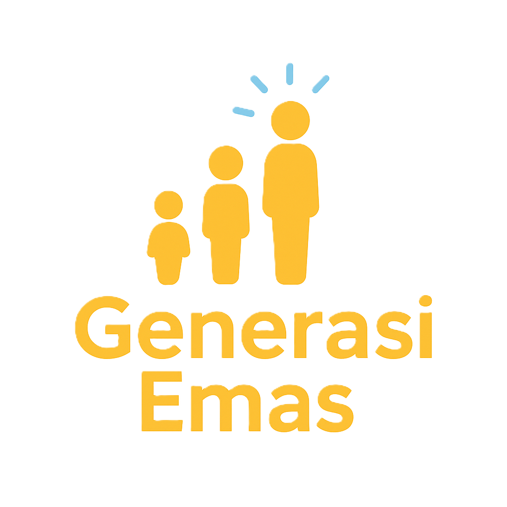
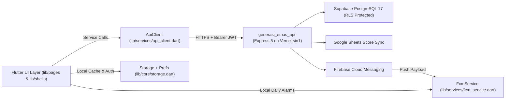

# ENICare Mobile App (`Generasi_Emas`)

<p align="center">
  
</p>

<p align="center">
  <strong><em>Empowering Neonatal Integrated Care — Model I-FINC</em></strong>
</p>

<p align="center">
  
  
  
  
  
  
</p>

**ENICare** (`com.enicare.app`) is the Flutter Android/iOS client for **Model I-FINC** (*Indonesian Family Integrated Neonatal Care*), empowering mothers, fathers, guests, and neonatal nurses to collaborate in daily NICU care. Designed for accessibility at maximum system font sizes and resilient offline hospital connectivity, it connects seamlessly with the `generasi_emas_api` backend.

---

## 2. Table of Contents

1. [Title and Introduction](#enicare-mobile-app-generasi_emas)
2. [Table of Contents](#2-table-of-contents)
3. [About](#3-about)
4. [Features](#4-features)
5. [Tech Stack](#5-tech-stack)
6. [Architecture](#6-architecture)
7. [Project Structure](#7-project-structure)
8. [Getting Started](#8-getting-started)
9. [Configuration](#9-configuration)
10. [Security](#10-security)
11. [How to Contribute?](#11-how-to-contribute)
12. [What's Next?](#12-whats-next)
13. [License](#13-license)
14. [Acknowledgements](#14-acknowledgements)
15. [Author](#15-author)

---

## 3. About

Parents with preterm or critically ill newborns in the NICU often face anxiety, fragmented schedules, and limited visibility into baby milestones. **ENICare** implements **Model I-FINC** by pairing educational resources (videos, interactive flipbook modules, peer-reviewed references) with structured daily participation tools (**Logbook Ibu**, **Jurnal Bayi**, **Jadwal Aktivitas Ibu di NICU**) and clinical nurse supervision—supporting **Mode Tamu (Guest)**, **Ibu**, **Ayah**, and **Perawat**.

---

## 4. Features

- **Accessibility & Adaptive Chrome:** Unclamped dynamic OS font scaling across all screens using `Flexible`, `Expanded`, `Wrap`, `IntrinsicHeight`, `ResponsiveActionButtonBar`, and `SingleChildScrollView`; consistent dark-icon `kLightSystemUiOverlayStyle` status bars; unified `EnicarePickerField` / `showEnicareOptionSheet` / `showEnicareDatePicker` pickers; reader scroll-lock toggle (`EnicareReaderSectionFrame`); `48x48 dp` minimum touch targets; and `SafeArea`-protected screens & bottom sheets.
- **Mode Tamu (Guest Access):** Instant unauthenticated access to `Video`, `Modul`, `Referensi`, Banner Carousel links, `Minimal Guest Profile`, app version footer on Start/Profile, explicit exit buttons back to Start (`Keluar dari Mode Tamu`), and interactive gate modals guiding users to login/register for clinical features.
- **Clinical Care Workflows (Ibu & Ayah):**
  - 14-slot hourly **Jadwal Aktivitas Ibu di NICU** (`06.00–06.00` WIB) with real-time `"Sedang Berlangsung"` highlight on Home & `GuidePage`.
  - 14-day **Logbook Ibu** matrix + **Jurnal Bayi** daily clinical summary (target for tapped notification reminders).
  - **Infant Growth Analytics:** WHO Z-Score Weight/Length/Head Circumference curves with `0 kg` ELBW/BBLR floor, **Berat Saat Lahir (`BBL`)** baseline marker at Month 0, preterm/BBLR clinical disclaimer banner, and offline read-through caching.
  - **Pre-Test, Post-Test 1–5 & Kuis:** Dynamic Google Form links & labels from CMS with automatic `POST /api/forms/sync-me` score refresh upon closing `InAppViewerPage`.
  - **Partner Linking:** WhatsApp-verified read-only Father monitoring linked via maternal approval.
- **Clinical Nurse Dashboard (`Perawat`):** Admin-managed salutation (`Ns.`, `Dr.`, `Bd.`, or omitted when empty), patient claiming (`Pasien Binaan`), growth curve clinical validation & notes, tab-locked `NestedScrollView` patient details, per-patient score sync (`?patientId=`), dynamic `Kuis Perawat`, and team Brainstorming view.
- **Dynamic Daily Reminders:** `flutter_local_notifications` scheduled daily in WIB synced dynamically with server `NOTIF_SCHEDULES_JSON` and gated by `User.notificationsEnabled`.

---

## 5. Tech Stack

| Component | Package / Tool | Version |
| :--- | :--- | :--- |
| Framework & Language | Flutter / Dart SDK | `3.50.1` / `3.14.0` (`>=3.5.0 <4.0.0`) |
| Android Toolchain | AGP / Gradle / Kotlin / JDK | `9.3.1` / `9.5.0` / `2.4.20` / Java `17` |
| HTTP & Connectivity | `http`, `connectivity_plus`, `flutter_dotenv` | `^1.2.2`, `^7.0.0`, `^5.1.0` |
| Persistence & Security | `flutter_secure_storage`, `shared_preferences` | `^11.2.0`, `^2.5.3` |
| Media & WebView | `webview_flutter`, `video_player`, `chewie`, `cached_network_image`, `youtube_player_flutter`, `url_launcher` | Latest pub-resolved versions in `pubspec.lock` |
| Push & Scheduling | `firebase_core`, `firebase_messaging`, `flutter_local_notifications`, `timezone` | `^5.1.0`, `^17.0.1`, `^23.0.1` |
| Metadata & Permissions | `package_info_plus`, `permission_handler` | `^10.2.2`, `^12.0.1` |

---

## 6. Architecture



---

## 7. Project Structure

```text
Generasi_Emas/
|-- android/
|   |-- app/build.gradle                 # com.enicare.app, compileSdk 37, desugaring, release signing
|   |-- settings.gradle                  # AGP 9.3.1, Kotlin 2.4.20, google-services 4.4.4
|   `-- gradle/wrapper/                  # Gradle 9.5.0
|-- assets/
|   `-- icon.png                         # App launcher & clinical header mark
|-- lib/
|   |-- main.dart, app.dart, routes.dart # App init, Material 3 ThemeData, route table
|   |-- firebase_options.dart            # Firebase platform options
|   |-- core/                            # age_calculator, constants, date_formatter, link_utils,
|   |                                    # maternal_guide_data, partner_sync, pdf_helper, storage,
|   |                                    # weight_formatter, youtube_helper
|   |-- services/                        # api_client.dart, fcm_service.dart
|   |-- shells/                          # patient_shell.dart, nurse_shell_4.dart
|   |-- widgets/                         # common.dart, growth_chart.dart, in_app_viewer_page.dart, loading_overlay.dart
|   |-- pages/                           # Patient, Guest, Auth, Consent, Logbook, Journal, Growth, Evaluations
|   `-- pages/nurse/                     # home_nurse_page, nurse_agg_page, patient_detail_page,
|                                        # nurse_assign_patient_page, quiz_nurse_page, brainstorming_nurse_page
`-- test/
    `-- weight_formatter_test.dart       # Unit tests for weights, nurse salutations, scores, NICU active slot
```

---

## 8. Getting Started

### Prerequisites
- Flutter `3.50.1+` (`flutter doctor`)
- Android Studio / Android SDK (`compileSdk 37`, JDK 17)
- Running instance of `generasi_emas_api`

### Local Development
```bash
cd Generasi_Emas
flutter pub get
cp .env.example .env
# Update dev_API_BASE_URL / API_BASE_URL in .env
flutter analyze
flutter test
flutter run
```

### Release Builds (Android)
1. Ensure `android/key.properties` is populated with your upload keystore credentials.
2. Build APK or AAB:
   ```bash
   flutter build apk --release
   flutter build appbundle --release
   ```

---

## 9. Configuration

### Environment Variables (`Generasi_Emas/.env`)
| Key | Description |
| :--- | :--- |
| `API_BASE_URL` | Default base URL for REST calls (overridden by `APP_ENV`) |
| `APP_ENV` | Environment selector (`prod` or `dev`) |
| `prod_API_BASE_URL`, `prod_APP_ENV` | Production API URL and label |
| `dev_API_BASE_URL`, `dev_APP_ENV` | Local/preview API URL and label |
| `APP_NAME` | Display application name (`ENICare`) |
| `API_TIMEOUT_SECONDS` | Default HTTP timeout duration (note: score sync uses an explicit 45s budget) |

---

## 10. Security

- **Credential Storage:** Access tokens are persisted in platform-encrypted storage via `flutter_secure_storage`; Guest mode explicitly skips authenticated calls until login.
- **Least-Privilege Permissions:** `AndroidManifest.xml` excludes unused audio/microphone recording permissions.
- **Safe Error Surfaces:** Release builds suppress raw Dart stack traces and framework assertions inside `ErrorWidget.builder`.
- **Firebase Key Restriction:** Always restrict Android API keys in Google Cloud Console to `com.enicare.app` + release SHA fingerprints, and regenerate `firebase_options.dart` via `flutterfire configure` prior to any iOS release.

---

## 11. How to Contribute?

1. Work inside `Generasi_Emas/` as its own Git repository.
2. Reuse shared helpers in `lib/widgets/common.dart` (`enicareAppBar`, `showAppInfoDialog`, `showAppConfirmDialog`, `showGuestGateDialog`, `sheetBottomPadding`) rather than duplicating modal or AppBar chrome.
3. Verify every UI change at **maximum Android system font scale** (zero `RenderFlex overflow` tolerance).
4. Before committing, run:
   ```bash
   flutter analyze
   flutter test
   ```
   Then run `graphify update .` from the parent workspace.

---

## 12. What's Next?

- Preterm growth curve overlays (Fenton / INTERGROWTH-21st) alongside WHO Child Growth Standards.
- Regenerate `lib/firebase_options.dart` with `com.enicare.app` bundle ID for iOS TestFlight / App Store release.
- Widget/integration tests covering Guest gating modals and Logbook submission.

---

## 13. License

Developed for academic clinical research and hospital neonatal care delivery (**Model I-FINC**). Redistribution outside authorized research institutions requires written permission from the clinical lead.

---

## 14. Acknowledgements

- **Eni Rahmawati** & clinical NICU partners for Indonesian neonatal copywriting, Logbook/Journal protocols, and 14-slot NICU bedside schedule.
- WHO Child Growth Standards methodology and open-source Flutter plugin authors.

---

## 15. Author

**ENICare Clinical & Mobile Team** — Led by Eni Rahmawati in collaboration with the ENICare full-stack engineering contributors. See in-app **Hubungi Peneliti / Admin** for research support contact details.
